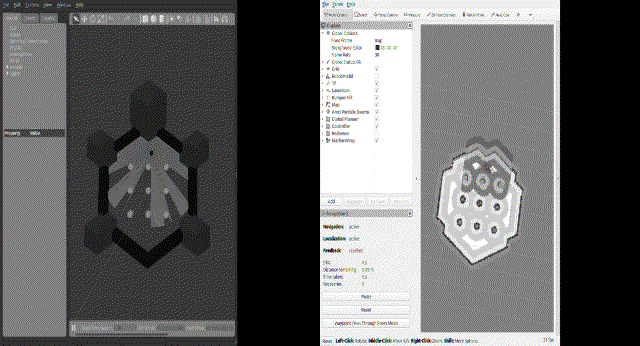
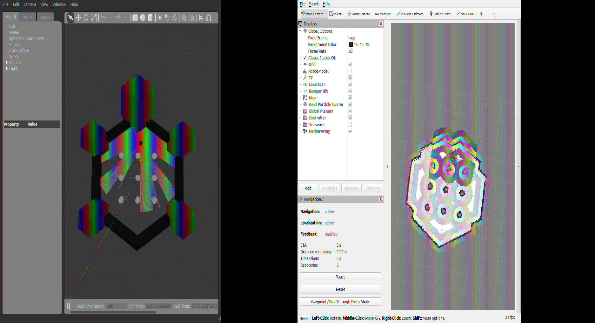
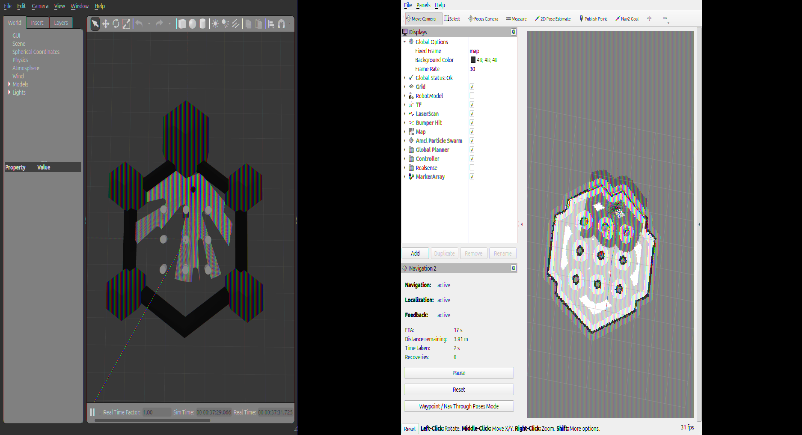
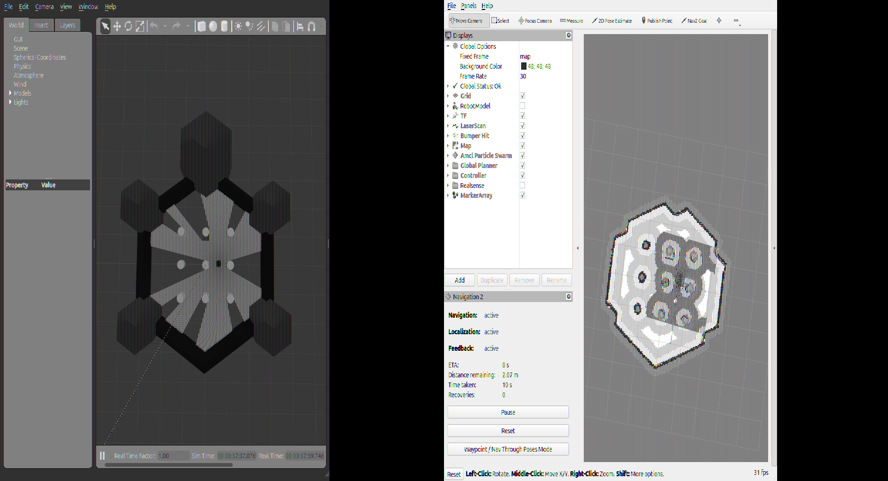
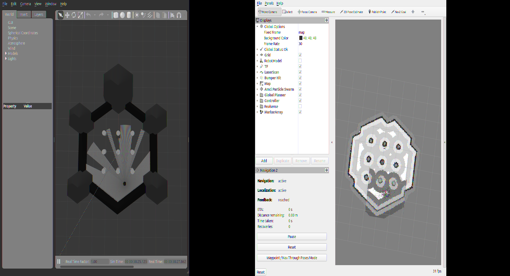

# Drive a Robot to a Goal (ROS 2 + Nav2)

Autonomous navigation task commanded via Nav2's `NavigateToPose` action client with dynamic obstacle avoidance and real-time path replanning in Gazebo simulation.

Developed by **Sanket** (Automation & Robotics student) for the Company Technical Assignment.

---

## Table of Contents
1. [Overview & Architecture](#overview--architecture)
2. [Simulation Demo & Screenshots](#simulation-demo--screenshots)
3. [Prerequisites & System Stack](#prerequisites--system-stack)
4. [Workspace Layout](#workspace-layout)
5. [Build Instructions](#build-instructions)
6. [Execution Guide](#execution-guide)
   - [Step 1: Simulation & Nav2 Bringup](#step-1-simulation--nav2-bringup)
   - [Step 2: Autonomous Goal Navigation](#step-2-autonomous-goal-navigation)
   - [Step 3: Bonus Dynamic Obstacle Replanning](#step-3-bonus-dynamic-obstacle-replanning)
6. [Expected Outputs](#expected-outputs)
7. [Screen Recording Script](#screen-recording-script)
8. [Troubleshooting & Real-World Fixes](#troubleshooting--real-world-fixes)
9. [Interview Explanations & FAQ](#interview-explanations--faq)

---

## Overview & Architecture

This repository delivers an end-to-end autonomous navigation stack:
* **Robot:** TurtleBot3 Burger (differential drive, 360° planar 2D LiDAR).
* **Simulator:** Gazebo Classic 11 with `turtlebot3_world`.
* **Localization:** AMCL (Adaptive Monte Carlo Localization) using Particle Filter over laser scans.
* **Navigation Stack:** ROS 2 Nav2 (NavFn global planner, DWB local controller, Behavior Tree navigator).
* **Custom Node (`nav2_goal_navigator`):** An asynchronous Python action client communicating over `/navigate_to_pose`.
* **Bonus Obstacle:** Dynamic runtime spawner that places an unmapped obstacle in the robot's trajectory, causing the local costmap obstacle layer to trigger real-time path replanning.

```text
+----------------------------------------------------------------------------+
|                             ROS 2 NAV2 STACK                               |
|                                                                            |
|   +-----------------------+                    +-----------------------+   |
|   |   Static Map File     |                    |   Laser Scan (/scan)  |   |
|   |  (nav2_map_server)    |                    +-----------+-----------+   |
|   +-----------+-----------+                                |               |
|               |                                            v               |
|               v                                 +----------------------+   |
|   +-----------------------+                     | Obstacle Layer       |   |
|   | Static Map Layer      |                     | (Dynamic detection)  |   |
|   +-----------+-----------+                     +----------+-----------+   |
|               |                                            |               |
|               +--------------------+-----------------------+               |
|                                    |                                       |
|                                    v                                       |
|                       +--------------------------+                         |
|                       | Costmap Inflation Layer  |                         |
|                       +-------------+------------+                         |
|                                     |                                      |
|                                     v                                      |
|                       +--------------------------+                         |
|                       |   Global/Local Costmap   |                         |
|                       +-------------+------------+                         |
|                                     |                                      |
|        +----------------------------+-----------------------------+        |
|        |                                                          |        |
|        v                                                          v        |
| +--------------+      +-------------------+      +-----------------------+ |
| | NavFn Global | ---> | Behavior Tree     | ---> | DWB Local Controller  | |
| | Planner      |      | Navigator (BT)    |      | (/cmd_vel)            | |
| +--------------+      +---------^---------+      +-----------+-----------+ |
+---------------------------------|----------------------------|-------------+
                                  | Action                     v
                                  | (/navigate_to_pose)  +------------+
                                  |                      | Gazebo Sim |
                   +--------------+-------------+        | (TurtleBot)|
                   | nav2_goal_navigator Node   |        +------------+
                   | (Custom Python Client)     |
                   +----------------------------+
```

---

## Simulation Demo & Screenshots

### 🎥 Live Autonomous Navigation Demo



*Split-screen demonstration: Gazebo Classic (left) showing the physical TurtleBot3 and runtime dynamic obstacle, and RViz2 (right) displaying global/local costmaps, AMCL particle filter, and real-time path replanning.*

> **Full Video Download:** [docs/media/simulation_demo.mp4](docs/media/simulation_demo.mp4) (60s, 1080p split-screen demonstration).

---

### 📸 Milestone Visual Gallery

| 1. Simulation & Map Overview | 2. Navigation in Progress |
|:---:|:---:|
|  |  |
| *Gazebo world with TurtleBot3 and RViz2 occupancy grid loaded.* | *Global path generated by NavFn planner; robot driving.* |

| 3. Dynamic Obstacle Avoidance & Replanning | 4. Goal Reached Successfully |
|:---:|:---:|
|  |  |
| *Unmapped red box detected by LiDAR; local costmap inflates lethal cost and replans.* | *Robot reaches final goal pose with `GOAL SUCCEEDED` status.* |

---

## Prerequisites & System Stack

* **Operating System:** Ubuntu 22.04 LTS or 24.04 LTS (x86_64)
* **ROS 2 Distribution:** Humble Hawksbill
* **Simulator:** Gazebo Classic 11 (`gazebo-11`)
* **Packages Required:**
  ```bash
  sudo apt update
  sudo apt install -y \
    ros-humble-desktop \
    ros-humble-navigation2 \
    ros-humble-nav2-bringup \
    ros-humble-turtlebot3* \
    ros-humble-gazebo-ros-pkgs
  ```

---

## Workspace Layout

```text
.
├── ASSUMPTIONS.md                   # Engineering decisions & rationale log
├── README.md                        # Complete documentation & execution guide
├── .gitignore                       # Ignores build/, install/, log/, and python cache
└── nav2_goal_task/                  # ROS 2 workspace root
    ├── maps/                        # Master copy of map files (also inside ROS pkg)
    │   ├── map.pgm
    │   └── map.yaml
    ├── config/                      # Master copy of Nav2 params (also inside ROS pkg)
    │   └── nav2_params.yaml
    ├── models/
    │   └── obstacle_box/            # SDF physical model for runtime obstacle injection
    │       ├── model.config
    │       └── model.sdf
    ├── scripts/
    │   └── spawn_obstacle.py        # Python script to spawn/delete entities via ROS 2
    └── src/
        └── nav2_goal_navigator/     # Custom ament_python ROS 2 package
            ├── config/              # Nav2 params (installed into pkg share via setup.py)
            │   └── nav2_params.yaml
            ├── maps/                # Map files (installed into pkg share via setup.py)
            │   ├── map.pgm
            │   └── map.yaml
            ├── launch/
            │   └── bringup_sim.launch.py   # Unified bringup (Gazebo + Nav2 + RViz)
            ├── nav2_goal_navigator/
            │   ├── __init__.py
            │   └── navigate_to_goal.py     # Asynchronous action client node
            ├── package.xml
            ├── resource/
            ├── setup.cfg
            ├── setup.py             # data_files installs maps/, config/, launch/ into share
            └── test/                       # Unit tests (flake8, pep257, copyright)
```

---

## Build Instructions

Always build inside the ROS 2 workspace root (`nav2_goal_task`):

```bash
cd /home/sanket/orca_robotics_task/nav2_goal_task

# Source underlay
source /opt/ros/humble/setup.bash

# Build the custom navigation package
colcon build --packages-select nav2_goal_navigator

# Run unit tests to verify style and docstring compliance
colcon test --packages-select nav2_goal_navigator
colcon test-result --all
```

---

## Execution Guide

### Option A: Unified Launch (Single Terminal Bringup)

```bash
export TURTLEBOT3_MODEL=burger
export GAZEBO_PLUGIN_PATH=$GAZEBO_PLUGIN_PATH:/opt/ros/humble/lib
source /opt/ros/humble/setup.bash
source /home/sanket/orca_robotics_task/nav2_goal_task/install/setup.bash

ros2 launch nav2_goal_navigator bringup_sim.launch.py
```

### Option B: Modular Terminals (Recommended for Inspection)

#### Terminal 1: Launch Gazebo Simulation
```bash
export TURTLEBOT3_MODEL=burger
export GAZEBO_PLUGIN_PATH=$GAZEBO_PLUGIN_PATH:/opt/ros/humble/lib
source /opt/ros/humble/setup.bash

ros2 launch turtlebot3_gazebo turtlebot3_world.launch.py
```

#### Terminal 2: Launch Nav2 Stack & RViz
```bash
export TURTLEBOT3_MODEL=burger
source /opt/ros/humble/setup.bash
source /home/sanket/orca_robotics_task/nav2_goal_task/install/setup.bash

ros2 launch nav2_bringup bringup_launch.py \
  use_sim_time:=True \
  map:=/home/sanket/orca_robotics_task/nav2_goal_task/maps/map.yaml \
  params_file:=/home/sanket/orca_robotics_task/nav2_goal_task/config/nav2_params.yaml
```

*(Note: In RViz, set the initial pose using **2D Pose Estimate** at $x=-2.0, y=-0.5$, or pass `-p publish_initial_pose:=true` to the navigation node).*

---

### Step 2: Autonomous Goal Navigation

In a new terminal, execute the custom navigation action client:

```bash
source /opt/ros/humble/setup.bash
source /home/sanket/orca_robotics_task/nav2_goal_task/install/setup.bash

# Navigate to target pose (x=1.8, y=0.0)
ros2 run nav2_goal_navigator navigate_to_goal --ros-args -p goal_x:=1.8 -p goal_y:=0.0
```

To test failure handling on unreachable goals:
```bash
# Out-of-bounds coordinates
ros2 run nav2_goal_navigator navigate_to_goal --ros-args -p goal_x:=10.0 -p goal_y:=10.0
```

---

### Step 3: Bonus Dynamic Obstacle Replanning

1. Spawn an unmapped red obstacle box in the corridor path:
   ```bash
   python3 /home/sanket/orca_robotics_task/nav2_goal_task/scripts/spawn_obstacle.py spawn --name dynamic_box --x 1.0 --y 0.5
   ```
2. Command navigation across that path:
   ```bash
   ros2 run nav2_goal_navigator navigate_to_goal --ros-args -p goal_x:=1.8 -p goal_y:=0.5
   ```
3. Observe RViz:
   - The robot's 2D LiDAR detects the new box.
   - The **local costmap** marks the box cells in yellow/red with an inflation radius.
   - The **global planner** automatically computes a bypass path around the obstacle.
   - The robot maneuvers smoothly around the box and reaches the goal.
4. Remove the obstacle when done:
   ```bash
   python3 /home/sanket/orca_robotics_task/nav2_goal_task/scripts/spawn_obstacle.py remove --name dynamic_box
   ```

---

## Expected Outputs

### Goal Success Terminal Output:
```text
[INFO] [nav2_goal_navigator]: Nav2GoalNavigator node initialized.
[INFO] [nav2_goal_navigator]: Waiting up to 10.0s for /navigate_to_pose action server...
[INFO] [nav2_goal_navigator]: Sending goal -> x: 1.80, y: 0.00, yaw: 0.00 rad
[INFO] [nav2_goal_navigator]: Goal accepted by Nav2. Robot is navigating...
[INFO] [nav2_goal_navigator]: [FEEDBACK] Distance remaining: 3.42 m | Time elapsed: 1 s
[INFO] [nav2_goal_navigator]: [FEEDBACK] Distance remaining: 1.85 m | Time elapsed: 6 s
[INFO] [nav2_goal_navigator]: [FEEDBACK] Distance remaining: 0.24 m | Time elapsed: 11 s
[INFO] [nav2_goal_navigator]: Navigation finished with status: SUCCEEDED
GOAL SUCCEEDED
```

### Goal Aborted Terminal Output:
```text
[INFO] [nav2_goal_navigator]: Sending goal -> x: 10.00, y: 10.00, yaw: 0.00 rad
[INFO] [nav2_goal_navigator]: Goal accepted by Nav2. Robot is navigating...
... (Nav2 executes recovery behaviors: spin, wait, backup) ...
[WARN] [nav2_goal_navigator]: Navigation failed with status: ABORTED
GOAL FAILED (status: ABORTED)
```

---

## Troubleshooting & Real-World Fixes

| Issue Encountered | Root Cause | Solution Applied |
|---|---|---|
| **Gazebo spawner hangs / timeout** | Gazebo Classic on Linux 6.8+ kernel needs loopback multicast and plugin path | Added `GAZEBO_PLUGIN_PATH` pointing to `/opt/ros/humble/lib` and enabled loopback multicast (`sudo ip link set lo multicast on`). |
| **Goal rejected immediately by Nav2** | `bt_navigator` was inactive because AMCL had no initial pose estimate | Set initial pose via `/initialpose` topic or RViz 2D Pose Estimate tool. |
| **Colcon test style errors** | flake8 and pep257 flagged docstrings, line lengths, and import ordering | Reordered imports alphabetically by standard-lib / third-party / local groups; refactored docstrings to imperative mood. |
| **Launch file fails after clean clone** *(Phase 7)* | `bringup_sim.launch.py` used `os.path.dirname(__file__)` traversal to find `maps/` and `config/`; after `colcon build`, `__file__` is the installed copy and the traversal pointed to the wrong directory | Moved `maps/` and `config/` inside the ROS package (`src/nav2_goal_navigator/`), added them to `data_files` in `setup.py`, and updated the launch file to use `get_package_share_directory('nav2_goal_navigator')` — the canonical portable approach. |

---
